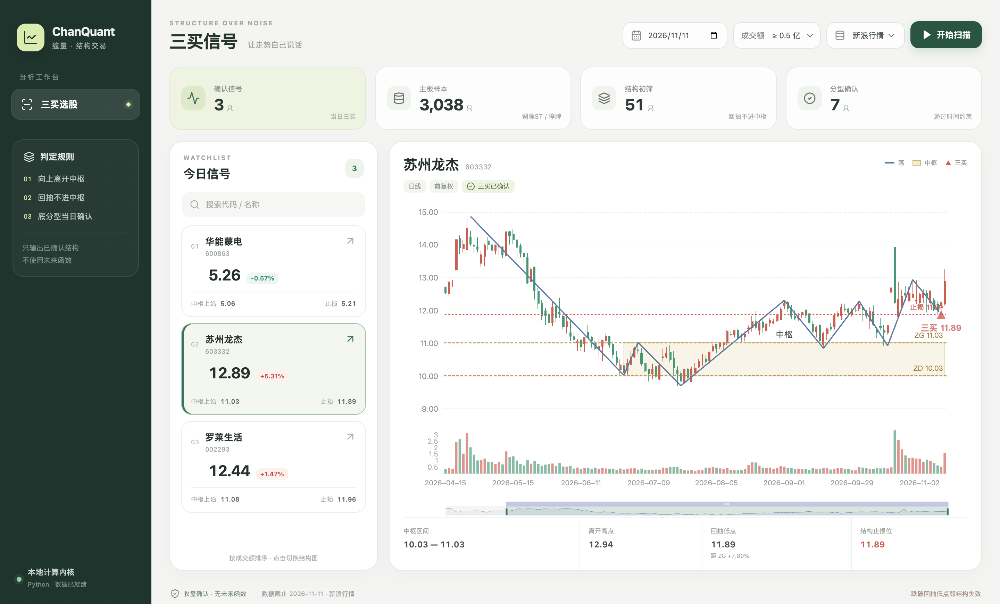
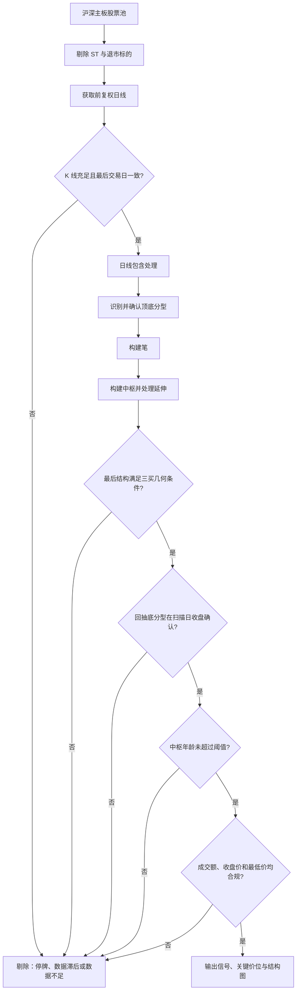
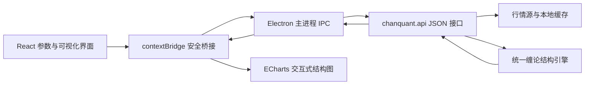

# ChanQuant


A 股缠论结构分析、三类买点筛选与桌面可视化工具。桌面端与命令行共用同一套 Python 缠论引擎，避免两套画笔规则产生结构分歧。

## 运行效果



## 主要功能

- 沪深主板股票池筛选，剔除 ST、退市、停牌或行情滞后的标的。
- 前复权日线包含处理、顶底分型、笔、中枢及中枢延伸识别。
- 严格检查向上离开、回抽不进入中枢、底分型当日确认等三买条件。
- 客户端交互式展示 K 线、笔、中枢、ZG/ZD、三买点和止损位。
- 支持成交额过滤、中枢年龄过滤、信号搜索、标的切换和扫描取消。
- 支持东方财富、新浪日线数据源及本地行情缓存。
- 命令行支持导出静态结构图到 `result/<日期>/`。

## 快速开始

### 1. 准备环境

- macOS、Windows 或 Linux；当前打包配置以 macOS 为主。
- Python 3.10 或更高版本。
- 桌面端建议使用 Node.js 20 或更高版本。

在项目根目录创建 Python 环境并安装依赖：

```bash
python -m venv .venv
source .venv/bin/activate        # Windows 使用 .venv\Scripts\activate
pip install -r requirements.txt
```

### 2. 启动桌面客户端

```bash
cd app
npm install
npm run dev
```

启动后只展示工作台，不会自动查询行情。设置扫描日期、成交额和行情源后，点击“开始扫描”才会执行全市场扫描；已有行情缓存覆盖当前日期区间时，日线数据会直接复用本地缓存。

### 3. 构建

```bash
cd app
npm run typecheck  # 严格 TypeScript 检查
npm run build      # 类型检查 + Electron 生产构建
npm run dist:mac   # 输出到 app/release/
```

macOS 应用图标位于 `app/build/icon.icns`，窗口和 Dock 使用 `app/build/icon.png`，可编辑矢量源文件为 `app/build/icon.svg`。

> 当前版本仍依赖项目根目录的 `.venv` 和 `chanquant` Python 模块。独立迁移到其他机器前，需要配置 Python 环境；内置 Python 运行时的完全独立发行包尚未完成。

## 客户端使用说明

### 扫描参数

| 参数 | 默认值 | 说明 |
| --- | --- | --- |
| 扫描日期 | 本地当天 | 只使用该日及之前的行情，不使用后续数据 |
| 最低成交额 | 0.5 亿元 | 过滤当日成交额低于阈值的标的 |
| 行情源 | 新浪 | 可切换东方财富；两个数据源分别缓存 |
| 中枢最大年龄 | 90 根 K 线 | 在“高级”区域调整，过滤过旧的中枢 |

点击“开始扫描”执行筛选，扫描过程中可点击“取消”。取消后保留上一次成功扫描的结果。

### 查看信号

1. 左侧列表按成交额展示当日确认的三买信号。
2. 点击股票卡片，右侧切换对应结构图。
3. 搜索框支持按股票代码或名称过滤。
4. 图表支持悬浮查看 OHLC、滚轮或拖动缩放、底部缩放条调整区间。
5. 图下方展示中枢区间、离开高点、回抽低点和止损位。

图表元素：

- 红涨绿跌蜡烛线：前复权日线。
- 蓝色折线：已确认的笔。
- 黄色区域及虚线：中枢区间、ZG 和 ZD。
- 红色三角形：三买确认位置。
- 红色点线：回抽笔低点，即当前结构止损参考位。

### 行情缓存与重新打开

- 每次打开客户端不会自动扫描；点击“开始扫描”后才重新计算全市场信号，且不会无条件重新下载全部日线。
- 股票池名单需要联网获取。
- 缓存默认保存在 `~/.cache/chanquant/daily`。
- 已有缓存的起止日期能够覆盖当前请求时，直接读取并裁剪到所需区间。
- 新交易日、切换数据源或缓存覆盖不足时，需要联网更新；当前尚未实现逐日增量更新。
- 扫描结果和结构计算结果不缓存，每次启动都会基于当前行情重新计算。

## 选股逻辑流程



### 1. 包含处理

相邻 K 线存在包含关系时，按照当前方向合并高低点，消除包含关系对分型识别的干扰。后续分型和笔均基于合并后的 K 线序列。

### 2. 分型

由连续三根合并 K 线识别顶分型和底分型。分型只有在右侧 K 线出现后才确认，引擎同时记录其确认索引，避免把尚未确认的分型用于历史扫描。

### 3. 笔

- 顶分型与底分型必须交替连接。
- 同类分型连续出现时保留更极端的顶或底。
- 分型之间必须满足引擎规定的最小 K 线间距。
- 笔保存起止位置、方向、高低点及确认索引。

### 4. 中枢

连续三笔存在价格重叠时构成中枢：

```text
ZG = min(前三笔高点)
ZD = max(前三笔低点)
```

后续笔只要仍与 `[ZD, ZG]` 存在重叠，就视为中枢延伸；不再重叠后停止延伸。

### 5. 三买确认条件

所有条件必须同时成立：

1. 存在已完成的中枢，并有向上离开段。
2. 离开段最高价严格高于 ZG。
3. 最后一笔为向下回抽笔，回抽起点和回抽低点均严格高于 ZG。
4. 回抽笔就是当前最后一笔，避免把历史旧信号当作当日信号。
5. 回抽底分型的确认索引必须等于扫描日索引，即 `last_raw - confirm_idx == 0`。
6. 扫描日收盘价严格高于 ZG。
7. 扫描日最低价未跌破回抽笔低点。
8. 中枢年龄和当日成交额均达到参数要求。

信号失效参考：**收盘跌破回抽笔低点**。系统展示的是已确认结构和失效位，不预测后续涨跌。

## 桌面端架构



Electron 开启 `contextIsolation` 和 `sandbox`，关闭 `nodeIntegration`。渲染进程不能直接访问文件系统或任意执行 Python，只能调用预加载脚本暴露的扫描和取消接口。

## 命令行使用

```bash
# 使用默认参数扫描指定日期
python -m chanquant.screener --date 20261111

# 指定新浪数据源、成交额和中枢年龄
python -m chanquant.screener \
  --date 20261111 \
  --source sina \
  --min-amount 1 \
  --max-pivot-age 60

# 导出信号静态结构图
python -m chanquant.screener --date 20261111 --source sina --plot

# 自定义取数起点、线程数和结果目录
python -m chanquant.screener \
  --date 20261111 \
  --start 20240101 \
  --workers 16 \
  --result-dir result/custom
```

常用参数：

| 参数 | 说明 |
| --- | --- |
| `--date` | 数据截止日，格式 `YYYYMMDD` |
| `--start` | 取数起始日，默认截止日前约 700 天 |
| `--source` | `eastmoney` 或 `sina` |
| `--min-amount` | 当日成交额下限，单位亿元 |
| `--max-pivot-age` | 中枢起点距扫描日的最大 K 线数 |
| `--workers` | 行情加载并发数 |
| `--no-cache` | 忽略本地缓存并重新取数 |
| `--plot` | 导出信号结构图 |
| `--result-dir` | 自定义静态图输出目录 |

## 项目结构

```text
ChanQuant/
├── app/
│   ├── build/                 # 应用图标资源
│   └── src/
│       ├── main/              # Electron 窗口、IPC、Python 子进程
│       ├── preload/           # 安全桥接接口
│       └── renderer/          # React 页面与 ECharts 图表
├── chanquant/
│   ├── engine.py              # 包含、分型、笔、中枢、三买
│   ├── data.py                # 行情加载与缓存
│   ├── api.py                 # 桌面端 JSON 接口
│   ├── screener.py            # 命令行扫描入口
│   └── plot.py                # 静态结构图
├── docs/desktop.png           # README 实际运行截图
├── result/                    # 命令行结构图输出
└── requirements.txt
```

## 环境变量

| 变量 | 用途 |
| --- | --- |
| `CHANQUANT_CACHE` | 覆盖行情缓存目录 |
| `CHANQUANT_ROOT` | 指定桌面端使用的项目根目录 |
| `CHANQUANT_PYTHON` | 指定 Python 解释器，默认优先使用根目录 `.venv` |

桌面端默认按以下顺序查找 Python：`CHANQUANT_PYTHON`、项目 `.venv`、`python3`。
